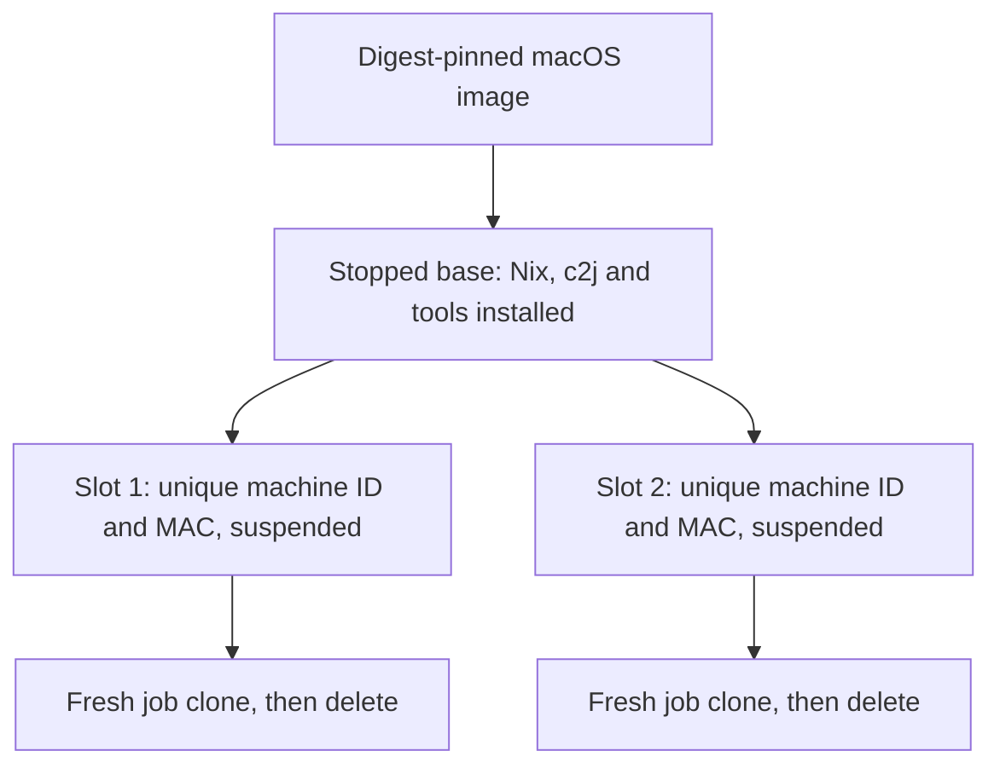

# macOS image lifecycle

The library and setup/upgrade commands use the same guest preparation scripts. Both produce a stopped prepared base and independently booted, suspended slot templates. Jobs always run in fresh clones.

## Initial preparation

The caller supplies bases, slot counts/sizes, an owner and durable state. Constructors perform no preparation; `Run`/`Reconcile` adopts existing named sources or prepares missing ones. The first install resolves `Config.C2JVersion` (`latest` by default) to a commit and uses Nix inside the guest to install c2j, the guest launcher, Git, Node/pnpm, uv and Python. Separate slots clone that shared prepared disk, configure their own CPU/memory/MAC, boot, verify tools/OS and suspend.

The transferred setup archive contains scripts and build definitions, not binaries or a VM image. It is an internal delivery mechanism that lets an application use the library without a repository checkout. There is no public bundle configuration and no c2j version compiled into the library.

Each cold macOS builder receives its own machine identifier and MAC before boot. Suspended clones retain those identities.

## Job execution

Admission reserves a slot durably, clones its suspended source and resumes the clone. The guest checks the saved boot UUID/MAC against its actual identity before accepting the lease. It invokes the installed launcher and c2j with the concrete execution base and actual resources. It performs no installation or release lookup.

The unprivileged c2j process receives the lease through stdin and uses it to retrieve secrets. A small guest launcher records execution intent so delivery retries cannot execute the same launch twice. launchd owns the service independently of SSH; the guest shuts down when c2j exits. Reconciliation deletes the exact owned, stopped clone and makes the slot available again.

## Updating without a Pulse release

Run `pulse-macvz upgrade` with the same owner/configuration after stopping the
controller. It drains accepted work before removing owned sources and rebuilding
capacity. Names identify owner/base/group/size/slot, never a c2j version. Changing
a library version or `C2JVersion` alone does not replace existing sources.

## Retention and recovery

`Close` preserves native resources. `Drain` stops admissions and releases slots after active work completes, keeping images for reuse. `PurgeImages` explicitly removes known, stopped sources after draining. Images not recorded in the runtime's inventory, including extra canonical aliases, are outside that operation.

VZ keeps ownership, preparation and delivery properties in each VM's private `pulse.json`. Restart reconstructs the pool from existing VMs; deletion removes the reservation. Pulse submits each LaunchID once. Native operations are never replayed, and ambiguous creation without a VM leaves no permanent reservation. Failed builders remain inspectable. There is no attempt to clean an executed VM for another job. See the README for legacy migration.
